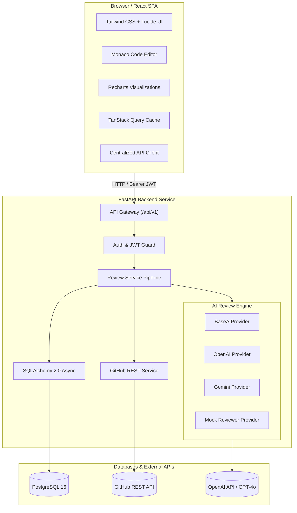

# AI Code Reviewer — Full-Stack Developer Platform

[](https://fastapi.tiangolo.com)
[](https://react.dev)
[](https://www.typescriptlang.org)
[](https://www.postgresql.org)
[](https://www.docker.com)
[](LICENSE)

A production-minded, full-stack code analysis platform designed to inspect source code snippets and live GitHub Pull Requests. It identifies demonstrable bugs, critical security vulnerabilities, performance bottlenecks, and maintainability concerns with grounded line references and one-click copyable suggested fixes.

---

## 1. Key Features

- **Robust Authentication & Session Management**:
  - User registration and login protected with cryptographic bcrypt password hashing.
  - Stateless signed JWT access tokens with expiration and Bearer authorization.
  - Strict ownership isolation: users can only view, filter, or delete their own reviews.
- **Pasted Code Review**:
  - Embedded **Monaco Editor** with dark theme and syntax highlighting.
  - Language selector with auto-detection heuristics across 10+ programming languages.
  - Review category selection (Bugs, Security, Performance, Maintainability) and depth settings.
  - Real-time client and server byte-size validation (100 KB limit).
- **GitHub Pull Request Integration**:
  - Validates GitHub PR URLs (`https://github.com/owner/repo/pull/123`).
  - Fetches actual changed file patches using the official GitHub REST API.
  - Filters out oversized binaries, lockfiles, and minified bundles.
  - Grounded line number correlation matching new and modified lines.
- **Actionable AI Findings**:
  - Structured output validated via Pydantic schemas.
  - Anti-injection shielding ensuring untrusted user code cannot hijack prompts.
  - Accurate severity tiers: `critical`, `high`, `medium`, `low`, and `info`.
  - One-click **Copy Fix** buttons for immediate code remediation.
- **Analytics Dashboard & Persistent History**:
  - Real-time metrics computed exclusively from database records (no fake/hardcoded stats).
  - Interactive **Recharts** visualizations for severity distributions and category breakdowns.
  - Paginated review history with search, status filtering, and modal-backed deletion.

---

## 2. Architecture Overview



---

## 3. Technology Stack

| Layer | Technologies |
|---|---|
| **Frontend** | React 19, TypeScript, Vite, Tailwind CSS v4, Monaco Editor (`@monaco-editor/react`), Recharts, TanStack Query v5, Lucide React |
| **Backend** | Python 3.11, FastAPI, Pydantic v2, SQLAlchemy 2.0 (Async), Alembic, HTTPX, PyJWT, Passlib / Bcrypt |
| **Database** | PostgreSQL 16 (production/Docker) & SQLite aiosqlite (zero-dependency local dev/tests) |
| **AI Providers** | OpenAI (`gpt-4o-mini`), Google Gemini (`gemini-1.5-flash`), Mock Provider (offline/CI) |
| **DevOps & Testing** | Docker, Docker Compose, Pytest, pytest-asyncio, Vitest, React Testing Library |

---

## 4. Database Schema

The database model is managed via SQLAlchemy ORM models with Alembic migrations:

### `users`
| Column | Type | Constraints / Description |
|---|---|---|
| `id` | VARCHAR(36) | Primary Key (UUID) |
| `name` | VARCHAR(100) | User full name |
| `email` | VARCHAR(255) | Unique, Indexed |
| `password_hash` | VARCHAR(255) | Bcrypt salted hash |
| `is_active` | BOOLEAN | Default True |
| `created_at` | TIMESTAMP | UTC timestamp |

### `reviews`
| Column | Type | Constraints / Description |
|---|---|---|
| `id` | VARCHAR(36) | Primary Key (UUID) |
| `user_id` | VARCHAR(36) | Foreign Key (`users.id` ON DELETE CASCADE) |
| `source_type` | VARCHAR(30) | `pasted_code` or `github_pr` |
| `title` | VARCHAR(255) | Optional custom review title |
| `language` | VARCHAR(50) | Detected or specified language |
| `status` | VARCHAR(20) | `pending`, `processing`, `completed`, `failed` |
| `model_provider` | VARCHAR(50) | e.g. `openai`, `gemini`, `mock` |
| `model_name` | VARCHAR(50) | Model identifier (e.g. `gpt-4o-mini`) |
| `review_summary` | TEXT | High-level executive review report |
| `critical_count` | INTEGER | Tally of critical severity findings |
| `high_count` | INTEGER | Tally of high severity findings |
| `medium_count` | INTEGER | Tally of medium severity findings |
| `low_count` | INTEGER | Tally of low severity findings |
| `info_count` | INTEGER | Tally of informational findings |

### `findings`
| Column | Type | Constraints / Description |
|---|---|---|
| `id` | VARCHAR(36) | Primary Key (UUID) |
| `review_id` | VARCHAR(36) | Foreign Key (`reviews.id` ON DELETE CASCADE) |
| `category` | VARCHAR(30) | `bug`, `security`, `performance`, `maintainability` |
| `severity` | VARCHAR(20) | `critical`, `high`, `medium`, `low`, `info` |
| `title` | VARCHAR(255) | Concise title of the issue |
| `description` | TEXT | Detailed explanation and exploit conditions |
| `file_path` | VARCHAR(500) | Relative path in repository |
| `start_line` | INTEGER | 1-indexed starting line number |
| `end_line` | INTEGER | 1-indexed ending line number |
| `code_snippet` | TEXT | Problematic code extract |
| `recommendation` | TEXT | Actionable remediation guidance |
| `suggested_fix` | TEXT | Copy-pasteable corrected code |
| `confidence` | FLOAT | Confidence score (0.0 - 1.0) |

---

## 5. REST API Contract

All application routes are versioned under `/api/v1`. Interactive documentation is available at `/docs` (Swagger UI) and `/redoc`.

| Method | Endpoint | Description | Auth Required |
|---|---|---|---|
| `GET` | `/health` | System and database health status | No |
| `POST` | `/api/v1/auth/register` | Register new user account | No |
| `POST` | `/api/v1/auth/login` | Authenticate and obtain JWT access token | No |
| `GET` | `/api/v1/auth/me` | Get profile of logged-in user | Yes |
| `POST` | `/api/v1/reviews` | Submit pasted code for review | Yes |
| `POST` | `/api/v1/reviews/github` | Submit GitHub PR URL for diff review | Yes |
| `GET` | `/api/v1/reviews` | List paginated reviews with filters | Yes |
| `GET` | `/api/v1/reviews/{id}` | Get review details and findings | Yes |
| `GET` | `/api/v1/reviews/{id}/status` | Get review processing status | Yes |
| `DELETE` | `/api/v1/reviews/{id}` | Delete a review and its findings | Yes |
| `GET` | `/api/v1/dashboard/summary` | Get aggregated dashboard metrics | Yes |

### Example Request: Create Pasted Review
```http
POST /api/v1/reviews HTTP/1.1
Host: localhost:8000
Authorization: Bearer <JWT_TOKEN>
Content-Type: application/json

{
  "code": "def divide(a, b):\n    return a / b",
  "language": "python",
  "title": "Math utility review",
  "categories": ["bug", "security", "performance", "maintainability"],
  "depth": "standard"
}
```

### Example Response:
```json
{
  "id": "e4a71bfb-65e3-4d69-bb19-4a929fa75bb2",
  "user_id": "943ab61a-2a3e-4bd7-9d34-4761ac30da96",
  "source_type": "pasted_code",
  "title": "Math utility review",
  "language": "python",
  "status": "completed",
  "model_provider": "openai",
  "model_name": "gpt-4o-mini",
  "review_summary": "Review completed. 1 critical issue identified regarding unhandled zero-division edge cases.",
  "total_findings": 1,
  "critical_count": 0,
  "high_count": 1,
  "medium_count": 0,
  "low_count": 0,
  "info_count": 0,
  "created_at": "2026-10-25T19:30:00Z",
  "completed_at": "2026-10-25T19:30:02Z",
  "findings": [
    {
      "id": "6732cf3d-5fcb-4172-881b-f95ae38936ef",
      "review_id": "e4a71bfb-65e3-4d69-bb19-4a929fa75bb2",
      "category": "bug",
      "severity": "high",
      "title": "Unhandled ZeroDivisionError in divide function",
      "description": "If b evaluates to zero, this statement raises an unhandled ZeroDivisionError exception.",
      "file_path": null,
      "start_line": 2,
      "end_line": 2,
      "code_snippet": "return a / b",
      "recommendation": "Validate that the denominator is non-zero before attempting division.",
      "suggested_fix": "if b == 0:\n    raise ValueError('Denominator b cannot be zero')\nreturn a / b",
      "confidence": 0.96,
      "created_at": "2026-10-25T19:30:02Z"
    }
  ]
}
```

---

## 6. Local Development Setup

### Prerequisites
- **Python**: 3.11+
- **Node.js**: v18+ (v22+ recommended) & npm
- **Git**

### Approach 1: Running Locally (Windows PowerShell)

#### Step 1: Clone and Navigate
```powershell
cd C:\Users\kanch\.gemini\antigravity\scratch\ai-code-reviewer
```

#### Step 2: Backend Setup
```powershell
cd backend
python -m venv .venv
.\.venv\Scripts\Activate.ps1
pip install -r requirements.txt

# Copy example environment configuration
Copy-Item .env.example .env

# Apply database migrations
alembic upgrade head

# Start backend server
uvicorn app.main:app --reload --host 127.0.0.1 --port 8000
```
*The backend is now live at `http://127.0.0.1:8000` with Swagger documentation at `http://127.0.0.1:8000/docs`.*

#### Step 3: Frontend Setup (In a New Terminal)
```powershell
cd C:\Users\kanch\.gemini\antigravity\scratch\ai-code-reviewer\frontend
npm install
npm run dev
```
*The frontend is now accessible at `http://localhost:5173`.*

---

### Approach 2: Running with Docker Compose

Ensure Docker Desktop is running on your machine:
```bash
# From project root
docker compose up --build -d
```

This starts:
- **PostgreSQL Database** on port `5432` with volume persistence
- **FastAPI Backend** on port `8000`
- **React Frontend (Nginx)** on port `80`

To stop the containers:
```bash
docker compose down
```

---

## 7. Automated Test Suite

Both backend and frontend contain automated unit and integration tests.

### Running Backend Tests (Pytest)
```powershell
cd backend
.\.venv\Scripts\pytest -v
```
**Test coverage highlights:**
- User registration, duplicate rejection, and password length validation
- Authentication and JWT token issuance
- Protected routes and profile retrieval (`/api/v1/auth/me`)
- Pasted code review pipeline with grounded line numbers
- Code length boundary validation (empty code, oversized input)
- Strict user ownership isolation (User B cannot access or delete User A's reviews)
- Review deletion and cascade cleanup
- GitHub PR URL parser and mock API integration
- Dashboard aggregates and severity calculations
- AI schema validation and mock reviewer detection rules

### Running Frontend Tests (Vitest)
```powershell
cd frontend
npm test
```
**Test coverage highlights:**
- `SeverityBadge`, `CategoryBadge`, and `StatusBadge` rendering
- `LoginPage` form rendering and validation feedback
- `RegisterPage` input rendering and password matching

---

## 8. Security & Data Retention Policy

- **Credential Isolation**: All provider secrets (`OPENAI_API_KEY`, `GEMINI_API_KEY`, `GITHUB_TOKEN`) are configured strictly server-side and never exposed to the client bundle.
- **Password Protection**: Passwords are saved with bcrypt salted hashing; plaintext is never stored or returned.
- **SQL Injection Prevention**: Parameterized queries via SQLAlchemy ORM.
- **Anti-Prompt-Injection**: System prompts instruct the LLM to treat all code, comments, commit messages, and PR descriptions as passive untrusted data.
- **Configurable Retention**: The `STORE_SOURCE_CODE=true` flag enables/disables persisting raw submitted code in the database.

---

## 9. Known Limitations & Roadmap

- **Multi-File Context**: Currently, GitHub PR reviews analyze changed patches up to 250 KB. Future iterations can incorporate full AST repository graphs for inter-file semantic analysis.
- **Direct GitHub Webhooks / Bot**: Future milestones include automatic PR commenting via GitHub GitHub App / Bot integrations.
- **Streaming Reviews**: Support Server-Sent Events (SSE) or WebSockets for real-time streaming LLM thoughts and findings.
